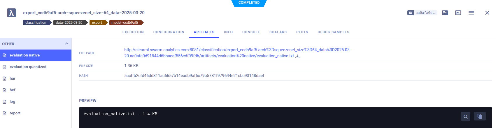
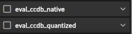

# onnx-2-hef converter


This docker image can be used to convert ONNX files to Hailo's .hef model format.

The docker image is based on hailo's docker image.

## usage

This container needs to be started via ClearML. The ClearML task needs to be launched as a child of a task that has an ONNX file in the artifact. The NMS config (optional, only for detection) need to be uploaded as an artifact beforehand. The fiftyone dataset to be used for quantization needs to be passed via an environment variable `DATASET="datasetname:snapshot_version"`.


```python
task = Task.current_task() # get or create task
task.set_parent(CLEARML_PARENT_ID) # ID of task with ONNX file (training task)
task.upload_artifact(name="nms", artifact_object=nms_file_path) # upload NMS config as artifacts if needed (detection)
task.upload_artifact(name="modelscript", artifact_object=modelscript_file_path) # upload modelscript file as artifacts if needed (otherwise default is used)

task.set_base_docker("swarm.azurecr.io/onnx-2-hef:latest",
    docker_arguments=f"-e DATASET={dataset} -e FIFTYONE_API_KEY=abc -e AZURE_STORAGE_CONNECTION_STRING=cde ..."
)
task.execute_remotely(str(queue))
```

Afterwards the converted model can be found in the tasks artifacts. Following artifacts get exported:

- `har`: Hailo model archive
- `hef`: Hailo model executable binary
- `report`: output of the Hailo profiler, includes expected performance metrics (FPS, latency, SNR)
- `evaluation_quantized`: inference evaluation of quantized model on test set
- `log`: output logs of the Hailo toolchain - may be relevant for troubleshooting




In the fiftyone dataset you can find evaluations of the floating point optimized model (native) and the quantized model:



Example run: [ClearML](http://clearml.swarm-analytics.com/projects/863c437f0a46443c90e56a0277de521a/experiments/499279852375406d8a7d021610f810be)


## notes

- Read through the logs carefully. Hailo parses the ONNX file with recommended `end_node_names`, check if those recommendations are valid!  
- You can set environmet variables: `OPTIMIZATION_LEVEL`, `COMPRESSION_LEVEL`, `COMPILATION_LEVEL`, `CALIBRATION_DATA_SIZE`, `PROFILING_DATA_SIZE` and `SKIP_PROFILING`. Defaults are set in `entrypoint.sh` and marked as **bold** below. Note that optimization level may be automatically adjusted if there is no GPU available and/or to less calibration data (again, check the logs!). Possible values are:
    - OPTIMIZATION_LEVEL: -100 (no compression), 0, 1, 2, 3, **4**; different algorithms are applied on levels 1-4
    - COMPRESSION_LEVEL: **0** (0), 1 (20), 2 (40), 3 (60), 4 (80), 5 (100); values in brackets show percentages of the weights that are compressed to 4 bit
    - COMPILATION_LEVEL: 0, 1, 2, **max**
    - CALIBRATION_DATA_SIZE: dataset size used for quantization optimization, recommended to be >1024 (default **2048**)
    - PROFILING_DATA_SIZE: dataset size used for profiling performance, recommended to be in range 64<size<200 (default **100**)
    - SKIP_PROFILING: if "true" testing and profiling is skipped for faster runtime (default **false**)
- Look at the SNR (signal-to-noise ratio) in the generated report. Values above 10 should be fine.

The runtime of the task is heavily dependent on the optimization levels. If both (`OPTIMIZATION_LEVEL` and `COMPILATION_LEVEL`) set to 0 the task usually finishes within a few minutes. With production settings (default), the process can take up to several hours.
